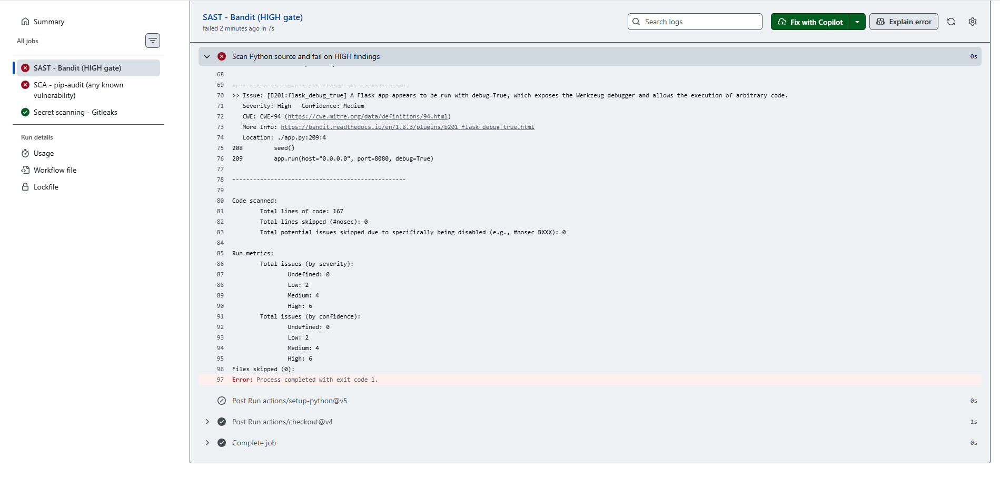

# Term Project Report — Secure Build

> Fill in every section. Keep the headings. Total **100 pts** (see rubric at the end).
> This is **team work** (2–3). Do not share your report with other teams.

## Cover

| Field | Value |
|---|---|
| **Team name** | Three Musketeers (Team 11) |
| **Members (name + ID)** | Sai Seng Main — 6631503085 |
| | Wilasinee Mangkorn — 6631503039 |
| | Pirisa Kitichai — 6631503031 |
| **Target application** | NoteVault |
| **Repository URL** | [https://github.com/Wilasinee3039/Three-musketeers] |
| **Date** | October 23, 2026 |

## AI-tool usage disclosure
*Academic integrity: state how you used any AI tools (ChatGPT, Copilot, etc.) — e.g. searching, coding, translating, drafting. "None" is a valid answer.*

| Tool | How it was used |
|---|---|
| Claude (Claude Code) | §6: generated the SBOM, signed the image, wrote the supply-chain CI workflow, and drafted the section. |
| Gemini | Understanding the project and what we needed to do. |
| ChatGPT | Assisted with project understanding, DFD, STRIDE analysis, vulnerability assessment, and remediation guidance. |

---

## 1. Executive Summary
*(½ page) What the app is, how many findings by severity, and the overall risk before vs. after your fixes.*

---

## 2. System Scope & Function

### 2.1 Application Overview

NoteVault is a web-based note management and sharing application developed using Python Flask. It allows users to register, log in, create and view personal notes, and search their notes. The application also provides an administrative endpoint for listing users and an export functionality.

### 2.2 System Components

- **Client:** A web browser used to interact with the application.
- **Backend:** A Python Flask application that handles HTTP requests, authentication, note management, search, and administrative functions.
- **Database:** SQLite, which stores user accounts and note information in two tables: `users` and `notes`.
- **Authentication:** JWT-based authentication using a session cookie.
- **Operating Environment:** A locally hosted application intended for security testing.

### 2.3 In-Scope Components

The security assessment covers:

1. User registration and login.
2. Session and authentication management.
3. Note creation, retrieval, and access control.
4. Note searching.
5. Administrative access.
6. Note export functionality.
7. Application dependencies, Docker configuration, and the build/release pipeline.

### 2.4 Data-Flow Diagram

The Data-Flow Diagram illustrates how user requests are processed by the Flask backend, how information is stored and retrieved from the SQLite database, and where trust boundaries exist between the client, application, database, and operating system.

The primary trust boundaries are between the user's browser and the application server, and between application-controlled inputs and sensitive backend resources.


---

## 3. Threat Model — STRIDE  *(20 pts)*

| Element / Data Flow | S | T | R | I | D | E | Top Threat & Mitigation |
|---|:---:|:---:|:---:|:---:|:---:|:---:|---|
| 1.0 Authentication / JWT | ✓ | ✓ | ✓ | ✓ | ✓ | ✓ | Hardcoded JWT secret, SQL injection, and weak MD5 password hashing. Use environment variables for secrets, parameterized queries, and Argon2id. |
| 2.0 Manage Notes / API | ✓ | ✓ | ✓ | ✓ | ✓ | ✓ | IDOR and stored XSS. Enforce note ownership checks and escape user-controlled HTML content. |
| 3.0 Search Notes | — | ✓ | — | ✓ | ✓ | — | SQL injection through search input. Use parameterized queries. |
| 4.0 Admin Functions | ✓ | ✓ | ✓ | ✓ | — | ✓ | Privilege escalation through user-controlled role assignment. Enforce server-side role assignment and authorization checks. |
| 5.0 Export / OS Shell | — | ✓ | — | ✓ | ✓ | ✓ | OS command injection through the export format parameter. Remove shell execution and validate allowed formats. |
| D1: Users / SQLite | ✓ | ✓ | ✓ | ✓ | ✓ | ✓ | Weak password hashing and sensitive account data exposure. Use Argon2id and restrict access to sensitive records. |
| D2: Notes / SQLite | — | ✓ | ✓ | ✓ | ✓ | — | Unauthorized note access. Enforce object-level authorization and ownership validation. |

**Note:** ✓ indicates a potential threat identified through source-code review, not a confirmed exploit.

### Top 5 Risks Ranked by Likelihood × Impact

1. **R-01: Remote Command Execution via /export (Risk Score: 25)**
   - Likelihood: 5, Impact: 5
   - Untrusted input passed directly to subprocess.run(..., shell=True) gives attackers total control of the host.
   - Mitigation: Remove shell execution; enforce a strict whitelist of export formats.

2. **R-02: SQL Injection in Authentication & Search (Risk Score: 25)**
   - Likelihood: 5, Impact: 5
   - Direct string formatting in SQL queries allows login bypass and full database dumping.
   - Mitigation: Use parameterized queries (prepared statements).

3. **R-03: Privilege Escalation via Mass Assignment on Registration (Risk Score: 20)**
   - Likelihood: 4, Impact: 5
   - /register accepts a role parameter without validation, letting attackers create admin accounts.
   - Mitigation: Hardcode newly registered accounts to role `"user"`.

4. **R-04: Broken Object-Level Authorization (BOLA/IDOR) on /api/notes/<nid> (Risk Score: 20)**
   - Likelihood: 5, Impact: 4
   - Any logged-in user can access any note ID without an ownership check, exposing admin secrets.
   - Mitigation: Verify owner == current_user before returning note contents.

5. **R-05: Stored Cross-Site Scripting (XSS) in Note Rendering (Risk Score: 12)**
   - Likelihood: 4, Impact: 3
   - Note body rendered with |safe allows JavaScript execution in victims' browsers.
   - Mitigation: Enable auto-escaping in templates and sanitize HTML.
---

## 4. Vulnerability Findings  *(25 pts)*

### Finding F-01 — Insecure Direct Object Reference (IDOR/BOLA)

| Field | Value |
|---|---|
| CWE | CWE-639 — Authorization Bypass Through User-Controlled Key |
| OWASP 2025 | A01:2025 — Broken Access Control |
| Severity | High |
| Location | `app.py` — `GET /api/notes/<nid>` |
| Reproduction | 1. Start the NoteVault application and log in as Alice (`alice` / `alicepw`). 2. Visit `http://localhost:8080/api/notes/1` to access Alice's own note. 3. Change the note ID to `2` by visiting `http://localhost:8080/api/notes/2`. 4. Before the fix, the application returns the Admin's private note even though Alice is not its owner. |
| Impact | An authenticated attacker can access private notes belonging to other users by manipulating note IDs, resulting in unauthorized disclosure of sensitive information. |
| Evidence | [before-own-note](evidence/F-01-IDOR/before-own-note.png) and [before-admin-note](evidence/F-01-IDOR/before-admin-note.png) |


---
### Finding F-02 — SQL Injection

| Field | Value |
|---|---|
| CWE | CWE-89: Improper Neutralization of Special Elements used in an SQL Command |
| OWASP 2025 | A05:2025 – Injection |
| Severity | Critical |
| Location | `app.py` — `POST /login` and `GET /search` |
| Reproduction | **Login:** 1. Open `http://localhost:8080/`. 2. Enter `' OR 1=1 -- ` as the username and `wrongpassword` as the password. 3. Submit the form. 4. Observe that authentication succeeds despite the incorrect credentials. **Search:** 1. Log in as `alice`. 2. Navigate to `/search`. 3. Enter `' OR 1=1 -- ` as the search term. 4. Observe that notes belonging to other users, including Admin, appear in the results. |
| Impact | An attacker can bypass authentication and access notes belonging to other users, resulting in unauthorized access and disclosure of sensitive information. |
| Evidence | [Before Login SQLi](evidence/F-02-SQLi/before-login-sqli.png) / [Before Search SQLi](evidence/F-02-SQLi/before-search-sqli.png) |


---
### Finding F-03 — Command Injection via /export

| Field | Value |
|---|---|
| CWE | CWE-78: Improper Neutralization of Special Elements used in an OS Command |
| OWASP 2025 | A05:2025 – Injection |
| Severity | Critical |
| Location | `app.py` — `GET /export` |
| Reproduction | 1. Log in as `alice` using `alicepw`. 2. Open `/export?fmt=txt` and observe `exporting notes as txt`. 3. Open `/export?fmt=txt%3Becho%20F03_INJECTION_TEST`. 4. Observe that `F03_INJECTION_TEST` appears on a separate line, proving that the injected shell command was executed. |
| Impact | An authenticated attacker could execute arbitrary operating-system commands through the `fmt` parameter, potentially compromising the application container and exposing sensitive data. |
| Evidence | [Before – Normal Export](evidence/F-03-Command-Injection/before-export-normal.png) / [Before – Command Injection](evidence/F-03-Command-Injection/before-export-command-injection.png) |


---
### Finding F-04 — Mass Assignment in Registration

| Field | Value |
|---|---|
| CWE | CWE-915: Improperly Controlled Modification of Dynamically-Determined Object Attributes |
| OWASP 2025 | A01:2025 – Broken Access Control |
| Severity | High |
| Location | `app.py` — `POST /register` (role assignment) |
| Reproduction | 1. Send a POST request to `/register` with `username=f04_test_admin`, `password=test12345`, and `role=admin`. 2. The application responds with HTTP 302, indicating registration was processed. 3. Query the SQLite database at `/tmp/notevault.db` for the newly created account. 4. Observe that the account has the `admin` role despite being created through public registration. |
| Impact | An unauthenticated attacker can create an account with administrator privileges by supplying `role=admin` during registration. This allows privilege escalation and potentially unauthorized access to administrative functionality and sensitive user data. |
| Evidence | [Before Fix – Admin Role Assignment](evidence/F-04-Mass-Assignment/before-register-admin.png) |

---

### Finding F-05 — Stored Cross-Site Scripting (XSS)

| Field | Value |
|---|---|
| CWE | CWE-79: Improper Neutralization of Input During Web Page Generation |
| OWASP 2025 | A05:2025 – Injection |
| Severity | High |
| Location | `app.py` — `GET /` (Home) and `GET /search` |
| Reproduction | 1. Log in as `alice` using `alicepw`. 2. Create a note with title `F05 XSS Test` and body ``. 3. Return to the Home page and observe the JavaScript alert `F05_XSS_TEST`. 4. Search for `F05_XSS_TEST` and observe the same alert on the Search results page. |
| Impact | An attacker can store malicious JavaScript in a note that executes when the note is rendered in a user's browser. This could enable unauthorized actions, manipulation of displayed content, or exposure of sensitive information accessible to the affected page. |
| Evidence | [Before Fix – Home XSS](evidence/F-05-Stored-XSS/before-home-xss.png) / [Before Fix – Search XSS](evidence/F-05-Stored-XSS/before-search-xss.png) |


---

## 5. Remediation  *(25 pts)*

### Fix for F-01 — Insecure Direct Object Reference (IDOR/BOLA)

**Before/After Code:**

```diff
- if not current_user():
+ user = current_user()
+ if not user:
      return jsonify(error="auth required"), 401

  con = db()
  r = con.execute(
-     "SELECT id,owner,title,body FROM notes WHERE id = ?",
-     (nid,)
+     "SELECT id,owner,title,body FROM notes WHERE id = ? AND owner = ?",
+     (nid, user)
  ).fetchone()
  con.close()

- return (jsonify(dict(r)) if r else (jsonify(error="not found"), 404))
+ if not r:
+     return jsonify(error="not found"), 404
+
+ return jsonify(dict(r))
```

**Why this fixes it:**

The original implementation only checked whether the user was authenticated, allowing any logged-in user to access another user's note by changing the note ID.

The fix adds an ownership check directly to the SQL query using `WHERE id = ? AND owner = ?`. This ensures that only the owner of a note can retrieve it. Unauthorized requests return `404 Not Found` without exposing private information.

**Commit:** `8188e9f` — `fix(F-01): prevent unauthorized note access (IDOR)`

**Proof the exploit now fails:**

After applying the fix and rebuilding the application, the endpoint was tested again using Alice's account.

- `/api/notes/1` → Alice can still access her own note.
- `/api/notes/2` → Returns `{"error":"not found"}` instead of exposing the Admin's private note.

**Evidence:**
   - [after-own-note](evidence/F-01-IDOR/after-own-note.png)
   - [after-admin-note](evidence/F-01-IDOR/after-admin-note.png)


---
### Fix for F-02

**Before/After — Login**

```diff
- q = "SELECT * FROM users WHERE username = '%s' AND password = '%s'" % (
-     username, hashlib.md5((password or "").encode()).hexdigest())
- row = con.execute(q).fetchone()
+ q = "SELECT * FROM users WHERE username = ? AND password = ?"
+ row = con.execute(
+     q,
+     (username, hashlib.md5((password or "").encode()).hexdigest())
+ ).fetchone()
```

**Before/After — Search**

```diff
- q = "SELECT id,title,body FROM notes WHERE owner='%s' AND body LIKE '%%%s%%'" % (user, term)
- rows = con.execute(q).fetchall()
+ q = "SELECT id,title,body FROM notes WHERE owner = ? AND body LIKE ?"
+ rows = con.execute(q, (user, f"%{term}%")).fetchall()
```

- **Why this fixes it:** Parameterized queries separate user input from SQL commands. User-supplied values are treated as data rather than executable SQL, preventing authentication bypass and unauthorized data retrieval through SQL Injection.
- **Commit:** `86f0990`-`fix(F-02): prevent SQL injection in login and search`
- **Proof the exploit now fails:** The original login injection payload returns `login failed` (HTTP 401), while the search injection returns no unauthorized notes.
  - [After Login SQLi](evidence/F-02-SQLi/after-login-sqli.png)
  - [After Search SQLi](evidence/F-02-SQLi/after-search-sqli.png)


---
### Fix for F-03

**Before/After Code:**

```diff
- out = subprocess.run("echo exporting notes as " + fmt, shell=True,
-                      capture_output=True, text=True)
+ allowed_formats = {"txt", "csv", "json"}
+ if fmt not in allowed_formats:
+     return "invalid export format", 400
+
+ out = subprocess.run(
+     ["echo", "exporting notes as", fmt],
+     capture_output=True,
+     text=True,
+     check=True
+ )
```

- **Why this fixes it:** The fix removes `shell=True` to prevent shell command execution and uses a list of arguments instead of concatenating user input into a command string. A strict whitelist only allows `txt`, `csv`, and `json` as valid export formats, preventing command injection through the `fmt` parameter.
- **Commit:** `2babb04`-`fix(F-03): prevent command injection in export`
- **Proof the exploit now fails:** The original payload `txt;echo F03_INJECTION_TEST` is rejected with `invalid export format`, while normal export functionality remains operational. 
   - [After Fix – Command Injection](evidence/F-03-Command-Injection/after-export-command-injection.png) 
   - [After Fix – Normal Export](evidence/F-03-Command-Injection/after-export-normal.png)


---
### Fix for F-04

**Before/After Code:**

```diff
- role = request.form.get("role") or (request.json or {}).get("role") or "user"
+ role = "user"
```

- **Why this fixes it:** The application no longer accepts the `role` value from user-controlled registration data. Every newly registered account is assigned the `user` role, preventing attackers from granting themselves administrator privileges through mass assignment.
- **Commit:** `474a0f5`-`fix(F-04): prevent mass assignment in registration`
- **Proof the exploit now fails:** The same registration request containing `role=admin` was submitted after remediation. The application created the account with the `user` role instead of `admin`, confirming that privilege escalation through the registration parameter is prevented. 
   - [After Fix – User Role Enforced](evidence/F-04-Mass-Assignment/after-register-admin.png)


---
### Fix for F-05

**Before/After Code:**

```diff
+ from markupsafe import escape
```

**Home (`/`)**

```diff
- notes_html = "".join(
-     "<li>#%d <b>%s</b>: %s</li>" % (r["id"], r["title"], r["body"]) for r in rows)
+ notes_html = "".join(
+     "<li>#%d <b>%s</b>: %s</li>" %
+     (r["id"], escape(r["title"]), escape(r["body"]))
+     for r in rows
+ )
```

**Search (`/search`)**

```diff
- return render_template_string("<a href=/>back</a><ul>" +
-     "".join("<li>%s: %s</li>" % (r["title"], r["body"]) for r in rows) + "</ul>")
+ return render_template_string(
+     "<a href=/>back</a><ul>" +
+     "".join(
+         "<li>%s: %s</li>" % (escape(r["title"]), escape(r["body"]))
+         for r in rows
+     ) +
+     "</ul>"
+ )
```

- **Why this fixes it:** The application now uses `markupsafe.escape()` to HTML-escape note titles and bodies before rendering them on the Home and Search pages. This ensures that user-controlled HTML and JavaScript payloads are displayed as text rather than interpreted and executed by the browser.
- **Commit:** `bf24736`-`fix(F-05): prevent stored XSS in notes and search`
- **Proof the exploit now fails:** After remediation, the original stored XSS payload `` was tested again on both pages. The payload was displayed as plain text, and no JavaScript alert appeared.
  - [After Fix – Home XSS](evidence/F-05-Stored-XSS/after-home-xss.png)
  - [After Fix – Search XSS](evidence/F-05-Stored-XSS/after-search-xss.png)


---
## 6. Supply-Chain Hardening  *(15 pts)*

### 6.1 SBOM (CycloneDX)

The SBOM was generated from the built container image with Syft 1.55.0 (CycloneDX 1.7 JSON): [`sbom.json`](./sbom.json).

```bash
docker build -t notevault:latest .
SYFT_FILE_METADATA_SELECTION=none syft notevault:latest -o cyclonedx-json=sbom.json
jq '.components | length' sbom.json   # 109
```

The SBOM was generated twice: once for the original image and once after hardening the Dockerfile and upgrading dependencies (§5). The committed `sbom.json` is the hardened image.

| Component type | Before (`python:3.12`, old deps) | After (hardened) |
|---|---|---|
| library (Debian OS packages + Python packages) | 482 | 101 |
| application | 7 | 7 |
| operating-system | 1 | 1 |
| **Total** | **490** | **109** |

Hardening cut the component count by **78%**. The original image used the full, unpinned `python:3.12` base, so most components were OS packages the app never uses, and it shipped the vulnerable `requirements.txt` versions (Flask 2.0.1, Werkzeug 2.0.1, Jinja2 3.0.1, PyJWT 1.7.1, requests 2.25.1, urllib3 1.26.4). The hardened image uses `python:3.12-slim` pinned by digest, runs as a non-root user, has no baked-in secret, and contains 14 Python packages at patched versions (Flask 3.1.3, Werkzeug 3.1.9, Jinja2 3.1.6, MarkupSafe 3.0.4, PyJWT 2.15.1, requests 2.34.2, urllib3 2.8.0). pip-audit reports no known vulnerabilities.

### 6.2 Image signed & verified with Cosign

The image was pushed to a local OCI registry and signed by digest with a Cosign key pair (Cosign v3.1.4). The public key is committed as [`cosign.pub`](./cosign.pub); the private key is git-ignored.

```bash
cosign generate-key-pair
cosign sign --key cosign.key localhost:5001/notevault@sha256:27f91e4d82b4136126129cbefcb055edd4cd7f9c09b495c5f2d7361d8194124e
cosign verify --key cosign.pub --insecure-ignore-tlog=true localhost:5001/notevault@sha256:27f91e4d82b4136126129cbefcb055edd4cd7f9c09b495c5f2d7361d8194124e
```

`cosign verify` output ([evidence](./evidence/supply-chain/cosign-verify.txt)):

```
Verification for localhost:5001/notevault@sha256:27f91e4d82b4136126129cbefcb055edd4cd7f9c09b495c5f2d7361d8194124e --
The following checks were performed on each of these signatures:
  - The cosign claims were validated
  - Existence of the claims in the transparency log was verified offline
  - The signatures were verified against the specified public key

[{"critical":{"identity":{"docker-reference":"localhost:5001/notevault@sha256:27f91e4d82b4136126129cbefcb055edd4cd7f9c09b495c5f2d7361d8194124e"},"image":{"docker-manifest-digest":"sha256:27f91e4d82b4136126129cbefcb055edd4cd7f9c09b495c5f2d7361d8194124e"},"type":"https://sigstore.dev/cosign/sign/v1"},"optional":{}}]
```

Negative check: verifying the same image with an unrelated public key fails ([evidence](./evidence/supply-chain/cosign-verify-wrong-key.txt)):

```
Error: no matching attestations: failed to verify signature: could not verify envelope: accepted signatures do not match threshold, Found: 0, Expected 1
```

Because the registry was local and offline, signing skipped the public Rekor transparency log (`--tlog-upload=false`), so verification uses `--insecure-ignore-tlog=true`.

### 6.3 Automated signing & provenance in CI

The [Supply Chain workflow](./.github/workflows/supply-chain.yml) runs on every push to `main`, separately from the Security CI gate. It:

1. builds the image on a GitHub-hosted runner and pushes it to `ghcr.io/wilasinee3039/three-musketeers`;
2. generates a CycloneDX SBOM of the pushed image (Syft via `anchore/sbom-action`);
3. signs the image **keylessly** with Cosign, using the workflow's GitHub OIDC identity (Fulcio certificate + public Rekor entry, so there is no long-lived key);
4. attaches the SBOM as a signed `cyclonedx` attestation;
5. generates signed **SLSA v1 build provenance** with `actions/attest-build-provenance`;
6. verifies all three and writes the results to the run summary.

Latest successful run (hardened image): [Actions run 39942935857](https://github.com/Wilasinee3039/Three-musketeers/actions/runs/39942935857), commit `ea25855`, image `sha256:2fa841a8…b60cb1`, SBOM 109 components.

`cosign verify` against the CI identity ([evidence](./evidence/supply-chain/ci-cosign-verify.txt)):

```
cosign verify ghcr.io/wilasinee3039/three-musketeers@sha256:2fa841a8760b5398ec59de6f6e86e608d01795100a5541b6c0d5e70654b60cb1 \
  --certificate-identity https://github.com/Wilasinee3039/Three-musketeers/.github/workflows/supply-chain.yml@refs/heads/main \
  --certificate-oidc-issuer https://token.actions.githubusercontent.com

Verification for ghcr.io/wilasinee3039/three-musketeers@sha256:2fa841a8760b5398ec59de6f6e86e608d01795100a5541b6c0d5e70654b60cb1 --
The following checks were performed on each of these signatures:
  - The cosign claims were validated
  - Existence of the claims in the transparency log was verified offline
  - The code-signing certificate was verified using trusted certificate authority certificates
```

Provenance verification ([evidence](./evidence/supply-chain/ci-provenance-verify.txt)):

```
gh attestation verify oci://ghcr.io/wilasinee3039/three-musketeers@sha256:2fa841a8... --repo Wilasinee3039/Three-musketeers

- Predicate type must match:................ https://slsa.dev/provenance/v1
- Source Repository URI must match:......... https://github.com/Wilasinee3039/Three-musketeers
- OIDC Issuer must match:................... https://token.actions.githubusercontent.com
✓ Verification succeeded!
  - Build repo:..... Wilasinee3039/Three-musketeers
  - Build workflow:. .github/workflows/supply-chain.yml@refs/heads/main
```

### 6.4 SLSA self-assessment

We assess NoteVault at **SLSA Build Level 2**. The image is built by a scripted process (Dockerfile + workflow) on a hosted build platform (GitHub-hosted runners), not on a developer machine. The build platform itself generates SLSA v1 provenance describing the source repo, commit, workflow and run, and signs it with a short-lived Sigstore certificate tied to the workflow's OIDC identity, so consumers can verify *how* and *where* the image was built, not just who signed it. The image signature and SBOM attestation use the same keyless identity and are recorded in the public Rekor log, so there is no long-lived private key to steal. We do not claim **Level 3**: provenance is generated by a step inside our own workflow rather than an isolated, non-forgeable builder (e.g. the `slsa-github-generator` reusable workflow), so a compromised workflow step could still influence it. The base image is now pinned by digest (`python:3.12-slim@sha256:…`), but transitive Python dependencies are not hash-pinned, so rebuilds are not fully reproducible. Hash-pinning dependencies and moving to the SLSA reusable workflow would be the next steps toward Level 3.

---

## 7. Security CI Pipeline  *(10 pts)*

### 7.1 Workflow

The pipeline is defined in [`.github/workflows/security.yml`](./.github/workflows/security.yml).
After pushing the file, runs are available under [GitHub Actions — Security CI](https://github.com/Wilasinee3039/Three-musketeers/actions/workflows/security.yml).
It runs on pushes, pull requests, and manual dispatches. Three independent jobs run the following checks:

| Check | Tool | Failure condition |
|---|---|---|
| SAST | Bandit 1.8.3 | At least one HIGH severity finding, at any confidence level. Bandit has no CRITICAL severity category. |
| SCA | pip-audit 2.9.0 | Any known dependency vulnerability, including HIGH/CRITICAL; this is stricter than a HIGH-only gate. Dependency collection errors also fail the audit through `--strict`. |
| Secret scanning | Gitleaks 8.24.2 | Any secret detected by the default rules in Git history. Output is redacted. Pattern scanning does not guarantee detection of every hardcoded password. |

Each scanner returns a non-zero exit code on a finding that meets its gate.
No scan uses `continue-on-error` or `|| true`, so a failed job makes the workflow fail.
These checks do not block merging automatically: repository branch protection or a ruleset must separately require the three job checks.

### 7.2 Failed-build evidence



**Figure 7.1:** GitHub Actions ran the **SAST - Bandit (HIGH gate)** job and reported **6 HIGH severity findings**. The screenshot shows B201 (`flask_debug_true`) at `app.py:209`, where `debug=True` enables the Flask debugger. The scan ended with **Process completed with exit code 1**, causing the job to fail. This demonstrates that the HIGH severity security gate works as configured.

The job list also shows that the SCA job failed and the Gitleaks secret-scanning job passed. The SCA failure reason must be checked in its own log; this screenshot only shows the detailed SAST findings.

- **Failed run URL:** (https://github.com/Wilasinee3039/Three-musketeers/actions/runs/39925428245/job/120320512106)
- **Screenshot:** [`img/security-ci-failed.png`](./img/security-ci-failed.png)

Local verification on October 23, 2026 with Python 3.12.2 and Bandit 1.8.3 also returned exit code **1** and reported **6 HIGH findings**: four B324 weak-MD5 findings, B602 shell execution at `app.py:202`, and B201 Flask debug mode at `app.py:209`.

The local pip-audit 2.9.0 run returned exit code **1**, reporting **47 known vulnerabilities in 7 packages**, including transitive dependencies. Counts may change as the advisory database changes.

After remediation, rerun the same workflow and retain the passing run as additional evidence.

---

## 8. Conclusion & Reflection  *(5 pts — clarity)*
- Residual risks and what you'd harden next.
- Lessons learned.

---

## Appendix

### A. Tools Used

| Tool | Purpose |
|---|---|
| Visual Studio Code | Source code editing and project development |
| Git & GitHub | Version control and team collaboration |
| Docker & Docker Compose | Running the NoteVault application locally |
| Python Flask | Backend web application framework |
| SQLite | Application database |
| GitHub Actions | Automated security CI pipeline |
| CycloneDX | Software Bill of Materials (SBOM) generation |
| Cosign | Release artifact signing and verification |
| ChatGPT | Technical explanations, security analysis guidance, and report drafting assistance |

### B. References

The following sources support the weakness classifications and remediation approaches in Sections 4 and 5. CWE identifies the specific weakness, while OWASP provides the broader risk category. The project's screenshots and test results provide evidence that the weakness occurred in NoteVault.

| Finding | CWE reference | OWASP reference | Application to this report |
|---|---|---|---|
| F-01: IDOR/BOLA | MITRE. [CWE-639: Authorization Bypass Through User-Controlled Key](https://cwe.mitre.org/data/definitions/639.html) | OWASP. [A01:2025 - Broken Access Control](https://top10.owasp.org/2025/A01_2025-Broken_Access_Control/) | A user could change the note ID to retrieve another user's note. The remediation checks ownership in the database query. |
| F-02: SQL Injection | MITRE. [CWE-89: Improper Neutralization of Special Elements used in an SQL Command ('SQL Injection')](https://cwe.mitre.org/data/definitions/89.html) | OWASP. [A05:2025 - Injection](https://top10.owasp.org/2025/A05_2025-Injection/) | Login and search queries previously incorporated user input into SQL text. Parameterized queries separate input values from SQL commands. |

Additional references for threat modeling, API security, and supply-chain hardening:

1. OWASP. [Top 10:2025](https://owasp.org/Top10/2025/).
2. OWASP. [API Security Top 10:2023](https://owasp.org/API-Security/editions/2023/en/0x11-t10/).
3. OWASP. [Threat Modeling](https://owasp.org/www-community/Threat_Modeling).
4. CycloneDX. [CycloneDX specification and documentation](https://cyclonedx.org/).
5. Sigstore. [Cosign documentation](https://docs.sigstore.dev/).
6. SLSA. [SLSA framework](https://slsa.dev/).

References accessed on October 23, 2026.

### C. Team Task Split

| Team Member | Responsibilities |
|---|---|
| Sai Seng Main | Project setup, Supply-Chain Hardening, SBOM generation, Cosign signing and verification, SLSA provenance, and supply-chain documentation. |
| Wilasinee Mangkorn | Vulnerability assessment and remediation for F-01 (IDOR), F-02 (SQL Injection), F-03 (OS Command Injection), and F-04 (Mass Assignment / Privilege Escalation), including evidence collection, report documentation, and Git integration. | |
| Pirisa Kitichai | Threat Modeling (System Scope, DFD, STRIDE Analysis), Security CI Pipeline implementation and testing, README documentation, and CI failure evidence collection. |

### D. Supporting Evidence

- Data Flow Diagram: `img/Data Flow Diagram.png`
- Vulnerability Evidence: `evidence/`
- SBOM: `supply-chain/sbom.json`
- Security CI Workflow: `.github/workflows/security.yml`

Additional evidence and remediation commit references will be updated as the project progresses.


---

## Grading rubric (100)

| Criterion | Pts |
|---|---|
| Threat model quality & completeness (§3) | 20 |
| Vulnerability findings — correctness, CWE/OWASP mapping, depth (§4) | 25 |
| Remediation quality — correct, minimal, well-explained (§5) | 25 |
| Supply-chain hardening — SBOM + signing + provenance (§6) | 15 |
| CI pipeline — works, fails build appropriately (§7) | 10 |
| Presentation & report clarity (§1, §8) | 5 |

*All work stays within the [ethics policy](../ETHICS.md).*
